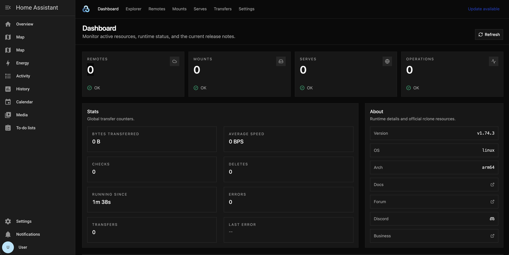

# Rclone Backup

Backup your Home Assistant configuration or backups to over [70 cloud providers](https://rclone.org/#providers) using [Rclone](https://rclone.org/).

The app has two parts:

- **Jobs** that you write in the app configuration. They copy or sync files on a schedule.
- **The Web UI**, where you add remotes, browse files and see what rclone is doing.

If this is your first time, do the steps in **Before you start** first. The app stops
on its first start if you skip them.

A typical configuration looks like this. It uses a remote called `google`, so add that remote before
you use it (see **Before you start**). If a job uses a remote that does not exist, the app stops when
it starts.

```yaml
jobs:
  - name: Sync Daily Backups
    schedule: 10 4 * * *
    command: sync
    sources:
      - /backup
    destination: 'google:/Backup/Home Assistant'
    include:
      - DailyBackup*
    exclude: []
    flags: {}
dry_run: false
config_path: /homeassistant/rclone.conf
```

## Before you start

The app reads your remotes (your storage accounts) from a file called `rclone.conf`. Every job names a
remote. If a job names a remote that is not in the file, the app stops when it starts, and you cannot
open the Web UI. The default job uses a remote called `google`. So you need a working `rclone.conf`
before the first start. An empty file is not enough.

The best way is to create and test the file on your computer, then copy it to Home Assistant. Many
providers, for example Google Drive and iCloud, open a page in your browser to log you in. The Web UI
inside Home Assistant cannot do that step.

### 1. Create and test the config on your computer

1. Install rclone on your laptop or desktop computer. See [Install rclone](https://rclone.org/install/).
2. Run `rclone config` and follow the questions to add a remote. Give it a short name without spaces,
   for example `mydrive`. If the provider needs a browser login, rclone opens the page for you.
3. Test the remote. Run `rclone lsd mydrive:` (use your remote's name). It lists the top-level
   folders of the remote. If you see an error, fix the remote before you continue.
4. Run `rclone config file`. It shows where the file is on your computer.

For more ways to set up a remote for a machine without a browser, see
[rclone remote setup](https://rclone.org/remote_setup/).

### 2. Copy the config to Home Assistant

1. If you do not have a way to edit files in Home Assistant, install an app that can. The
   [File editor](https://my.home-assistant.io/redirect/supervisor_addon/?addon=core_configurator) app
   is the usual choice.
2. Open the file editor and go to the top-level folder, where `configuration.yaml` is. This app sees
   that folder as `/homeassistant`.
3. Create a new file called `rclone.conf`.
4. On your computer, open the file from step 1, copy all of its contents, paste them into the new file
   and save it.

The full path of the file is now `/homeassistant/rclone.conf`. This is the default value of the
`config_path` option, so you do not need to change that option.

*Note: the file contains the passwords and tokens for your accounts. Keep it as safe as a password.*

*Note: if you prefer not to create a file, you can paste the same contents into the
`rclone_config` option instead.*

### 3. Set up your jobs and start the app

1. Go to the app's **Configuration** tab.
2. In each job, use the name of your remote. For example, change
   `destination: google:/Backup/Home Assistant` to `destination: 'mydrive:Backup/Home Assistant'`.
   The name must match the name in `rclone.conf` exactly, and a colon (`:`) must follow it.
3. Set `dry_run` to `false`. The default is `true`. With `true`, rclone only shows in the log what it
   would do, and it does not copy or delete files. You can keep `true` for the first run, check the
   log, and then change it to `false`.
4. Start the app.
5. If the app stops, open its **Log** tab. The log names the remote that it did not find. Correct the
   name in the **Configuration** tab, or add the remote to `rclone.conf`, and start the app again.
6. Select **Open Web UI**. You do not need a username or password. The **Dashboard** shows how many
   remotes the app found.

The app reads and checks the jobs only when it starts. After you change a job or add a remote that a
job uses, restart the app.

## Using the Web UI

Select **Open Web UI** on the app's **Info** tab to open the
[rclone-web](https://github.com/rclone/rclone-web) interface inside Home Assistant.



Not every tab works inside Home Assistant. This table shows what to expect:

| Tab           | Status        | What to know                                                           |
| ------------- | ------------- | ---------------------------------------------------------------------- |
| **Dashboard** | Works         | Shows remotes, mounts, transfer counters and the rclone version.       |
| **Explorer**  | Works, limits | You can only see the folders that the app's security profile allows.  |
| **Remotes**   | Works, limits | You cannot add a provider that logs in through a browser page here.    |
| **Mounts**    | Works, limits | Share on your network with Samba share. A restart removes it.          |
| **Serves**    | Does not work | Serves did not work in testing. Do not use this tab.                   |
| **Transfers** | Works         | Copy and move files.                                                   |
| **Settings**  | Works         | Needs `/homeassistant/rclone.conf` to exist before the app starts.     |

### Explorer

Explorer shows the files that rclone can see. The app runs rclone under an
[AppArmor](https://contributors.home-assistant.io/apps/guides/security/#apparmor) security profile, which
allows only these folders:

| Folder           | What it contains                         | Access     |
| ---------------- | ---------------------------------------- | ---------- |
| `/homeassistant` | Your Home Assistant configuration        | Read/write |
| `/backup`        | Home Assistant backups                   | Read/write |
| `/share`         | The shared folder                        | Read/write |
| `/media`         | The media folder                         | Read/write |
| `/addons`        | Local apps                               | Read/write |
| `/addon_configs` | The configuration folders of other apps  | Read/write |
| `/ssl`           | Certificates                             | Read-only  |

Explorer shows other folders in the top level, for example `/etc` or `/root`, but you cannot open them.
When you try, Explorer shows an error and AppArmor blocks the access. The block is expected. To see
what AppArmor blocked, look in the logs for lines that contain `apparmor="DENIED"` and
`rclone_backup`.

### Remotes

A remote is a connection to a storage provider, for example Google Drive, an S3 bucket or an SFTP
server.

You can add a remote in the Web UI only if the provider does not need a browser login. For example,
S3, SFTP and WebDAV use keys or passwords, so they work. Google Drive and iCloud open a login page in
a browser, and the Web UI cannot do that. For those, create the remote on your computer and copy the
config, see **Before you start**.

To add a remote in the Web UI:

1. Select **Remotes** → **Add New Remote**.
2. Give the remote a short name without spaces, for example `mydrive`. You use this name in your jobs.
3. Select the provider and fill in its settings. The [rclone docs](https://rclone.org/docs/) describe
   the settings for each provider.
4. Save the remote. The Web UI writes it to `/homeassistant/rclone.conf`.
5. If a job uses the new remote, restart the app.

### Mounts

A mount makes a remote look like a local folder. Before you start, know these limits:

- **The mount stays inside this app.** It does not appear on your network by itself. To share it,
  mount it under `/share` or `/media`, then use the Samba share app to share that folder.
- **A mount does not survive a restart.** When the app restarts, or Home Assistant restarts, the mount
  is gone. You must create it again.
- **The mount folder must already exist.** The Web UI does not create it.

To create a mount:

1. Create an empty folder for the mount. Select **Explorer**, open `/share` (or `/media`), select
   **New Folder** and give it a name, for example `rclone`.
2. Select **Mounts** → **New Mount**.
3. Select the remote. In **Mount Point**, type the full path of the folder from step 1, for example
   `/share/rclone`.
4. Create the mount. The remote's files now show in that folder, inside this app.

After each restart of the app or of Home Assistant, do steps 2 to 4 again.

### Serves

Serves did not work in testing. Do not use this tab.

### Settings

Settings shows the path and the contents of the rclone config file, and lets you change global rclone
options.

## Configuration

**Option:** `jobs`

A list of jobs to schedule, see the **Job Config** section for a list of available options.

**Option:** `flags`

Global map of flags to give the rclone command for every job, see [rclone flags](https://rclone.org/flags). Underscores are allowed for the flags and they will be replaced with dashes.

```yaml
jobs:
  - ...
flags:
  drive-use-trash: false
  min-age: 30d
```

*For example, you may want to add `drive-use-trash: false` when using google drive so rclone immediately deletes files instead of sending them to the trash.*

**Option:** `extra_flags`

List of flags to give the rclone command, applied globally to all jobs. For use when `flags` option isn't working, the list of flags are appended directly to the rclone command.

```yaml
jobs:
  - ...
extra_flags:
  - --drive-use-trash=false
  - --min-age=30d
```

**Option:** `dry_run`

Trial run with no permanent changes, see what rclone would do without actually doing it. The default
is `true`, so set it to `false` when your jobs are ready.

**Option:** `run_once`

Will run all jobs with no schedule defined immediately then exit. Designed for use with the `hassio.addon_restart` service to trigger jobs.

**Option:** `config_path`

The location of the rclone config file. The default is `/homeassistant/rclone.conf`. The file must
exist before the app starts, see **Before you start**. `/config` is another name for
`/homeassistant`, so older paths such as `/config/rclone.conf` still work.

**Option:** `rclone_config`

This allows you to specify the rclone config from within the addon configuration, defining it will take precedence over the `config_path` option.

```yaml
jobs:
  - ...
rclone_config: |
  [google]
  type = drive
  scope = drive
  token = REDACTED
  use_trash = false
```

**Option:** `no_rename`

Disable the renaming of backups before uploading them, with this enabled backups will use their slug id (their name on disk) instead of their friendly name.

**Option:** `no_unrename`

Prevents renaming backups back to their original name, with this enabled the backup files will be renamed to use their friendly name and this will persist on disk.

*Note: this option can apparently cause issues with restoring backups through the WebUI, however, selecting **⋮** → **Reload** should fix it. 
This won't affect the actual integrity of the backups.*

**Option:** `no_slugify`

This will disable the slugification of backup names. This means the **user** is responsible for ensuring their backup names are **valid** filenames for their filesystem and the destination filesystem.

**Option:** `no_events`

Disable sending completion and failure events to Home Assistant.

## Job Config

**Option:** `sources`

List of source locations in the format `remote:path` or for local paths just `path`, e.g. `/backup`, `/config`, `/share`, `/ssl`, `/media`.

**Option:** `source`

A slightly cleaner way to specify a single source, this option will override the `sources` option.

**Option:** `destinations`

A list of locations to write to in the format `remote:path` or for local paths just `path`, see [rclone docs](https://rclone.org/docs).

**Option:** `destination`

A slightly cleaner way to specify a single destination, this option will override the `destinations` option.

> **Multiple Sources**
>
> When there are multiple sources each source will be backed-up to the destination under `destination/source`
> otherwise they will be directly under `destination`.
>
> **Multiple Destinations**
>
> All sources are backed-up to each destination following the rules for multiple sources mentioned above.

**Option:** `name`

Optionally you can provide a friendly name for the job, this can be useful to identify which job is being run when you have multiple.

**Option:** `schedule`

Specify when the rclone backup should run using cron syntax. If the `schedule` option is empty or undefined the job will be run when the addon starts.

**Option:** `command`

The rclone command to run e.g. `sync`, `copy`, `move`.

**Option:** `include`

List of files or folders to include, see [rclone filtering](https://rclone.org/filtering).

*Note: these filters are matching the backups name on the filesystem, if you have not disabled renaming then this will be a slugified version of the backups name, this will effectively replace all special characters with an `_` and remove duplicate underscores.*

To preview the slugified names of your backups you can add a startup job like the following.

```yaml
jobs:
  - command: ls
    name: List Local Backups
    sources:
      - /backup
```

**Option:** `exclude`

List of files or folders to exclude, see [rclone filtering](https://rclone.org/filtering).

**Option:** `flags`

Map of flags to give to the rclone command, see [rclone flags](https://rclone.org/flags).

**Option:** `extra_flags`

List of flags to give the rclone command, applied globally to all jobs. For use when `flags` option isn't working, the list of flags are appended directly to the rclone command.

---

### Configuring Rclone Remotes

To add a remote in the Web UI, see **Remotes** (under **Using the Web UI**). For providers that need a browser login, create
the remote on your computer and copy the config, see **Before you start**. The
[rclone docs](https://rclone.org/docs/) describe each provider.

---

## Events

> Blueprint to send notifications based on these events. [[source]](https://github.com/jcwillox/home-assistant-blueprints)
>
> [](https://my.home-assistant.io/redirect/blueprint_import/?blueprint_url=https%3A//raw.githubusercontent.com/jcwillox/home-assistant-blueprints/main/automation/notify_rclone_backup.yaml)

The addon will fire events using Home Assistant's event bus whenever a job is completed or fails.

**Event:** `rclone_backup.job_successful`

**Event:** `rclone_backup.job_failed`

Both events will have the following attributes.

| Attribute     | Description                                            |
| ------------- | ------------------------------------------------------ |
| `name`        | The name of the job.                                   |
| `command`     | The rclone command that was run.                       |
| `source`      | The source location.                                   |
| `destination` | The destination location. (optional)                   |
| `error`       | The error message if the job failed. (optional)        |
| `duration`    | The duration of the job as a human string, eg. `1m2s`. |
| `seconds`     | The duration of the job in seconds.                    |
